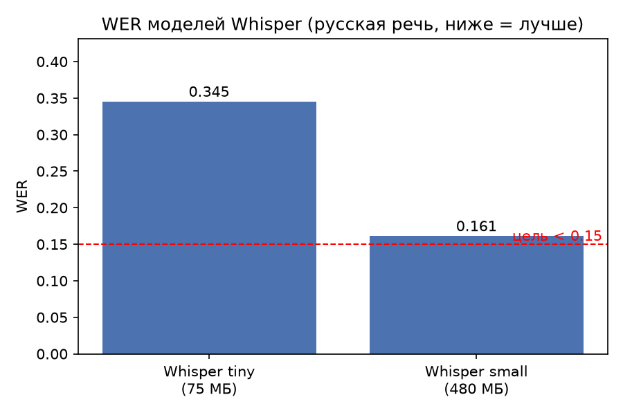
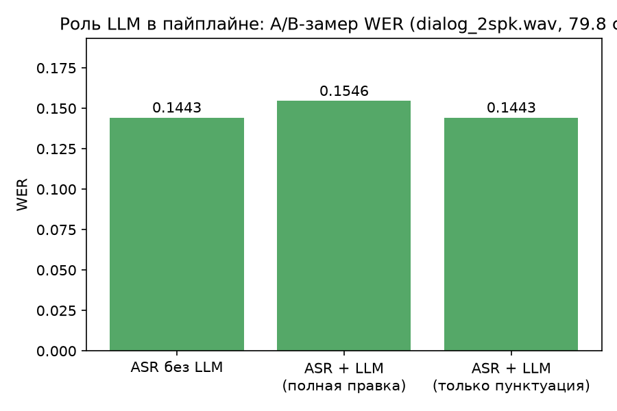
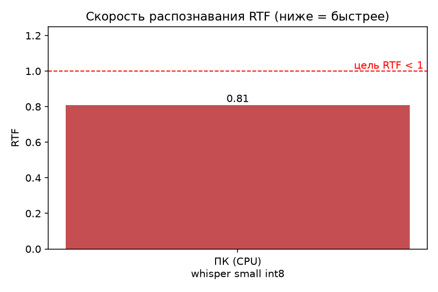

# Выбор моделей ML (зона feature/ml)

Все цифры — реальные измерения на этом репозитории, если не указано иное.
Устройство замеров на ПК: Windows, CPU (без GPU). Целевое устройство: Android (SM-S938B).

## Архитектура ML-пайплайна (на устройстве)

```
аудио (любой формат)
  → AudioConverter (MediaCodec) → WAV 16 кГц моно  [один раз, AudioPrep]
  → Whisper base (whisper.cpp, JNI, CPU arm64) → сегменты с таймкодами
  → диаризация sherpa-onnx (pyannote-3.0 + 3D-Speaker + кластеризация)
  → SpeakerPostProcess: склейка пауз, деление пауз между говорящими
  → сшивка реплик с говорящими (Merge)
  → локальная LLM Qwen2.5-0.5B (только пунктуация/регистр, с проверкой)
  → Transcript JSON {"transcript":[{speaker_id,start_ms,end_ms,text}]}
```

Инференс полностью локальный: в манифесте нет разрешения INTERNET
(проверено `aapt2 dump permissions`).

## ASR на устройстве: реализация

- Движок: **whisper.cpp** (master), собран из исходников в APK через
  CMake/NDK (`android/app/src/main/cpp/`). faster-whisper не подошёл:
  у ctranslate2 нет Android-сборок (проверено по PyPI).
- Модель: **ggml-small-q5_1.bin** (181 МБ, лицензия MIT, формат GGML,
  квантование q5_1). Лежит в `assets/models/`, при первом запуске копируется
  в `filesDir`.

  Выбор сделан по замерам на устройстве (SM-S938B, 20 записей VoxForge RU):

  | Модель | WER | RTF (диалог 80 с) | Размер |
  |---|---|---|---|
  | tiny | 0.368 | 0.10 | 74 МБ |
  | base | 0.245 | 0.13 | 141 МБ |
  | small (f16) | 0.170 | 0.35 | 465 МБ |
  | **small q5_1** | **0.178** | **0.31** | **181 МБ** |

  Взята small q5_1: квантование стоило 0.8 п.п. WER, но сэкономило 284 МБ.
  Транскрибация — 40 баллов из 100, скорость — 10, поэтому tiny не оправдан.

  Ранние замеры (RTF 16.44 у small, 5.88 у base) были сделаны в Debug-сборке,
  где нативный код компилировался с `-O0`. После перехода на RelWithDebInfo
  и Release те же модели дали RTF 0.31–0.35.

- Длинные записи обрабатываются **окнами по 30 секунд без перекрытия**:
  весь WAV не поднимается в память, PCM освобождается после каждого окна,
  таймкоды сдвигаются к абсолютному времени. Перекрытие пробовалось и убрано:
  whisper повторял конец окна в начале следующего, и постобработкой это
  надёжно не снималось (повтор разорван словами и в другой форме).
- Фильтр галлюцинаций: маркеры титров и музыкальных вставок
  («редактор субтитров», «продолжение следует», «[музыка]» и т.п.).
  Кириллица приводится к нижнему регистру вручную: `std::tolower` работает
  только с ASCII, из-за чего фильтр раньше не срабатывал.
- Код: `engine/WhisperBridge.kt` (JNI), `engine/WhisperAsrEngine.kt`,
  `android/app/src/main/cpp/whisper_jni.cpp`.
- Оптимизации (коммит 41295b4): `flash_attn = true`, автоподбор потоков
  (`hardware_concurrency/2`, в пределах 4–8), замер RTF в logcat (тег WhisperJNI),
  greedy-декодинг, `no_context = true` против зацикливания.
- Фильтр спецтокенов (коммит cf1d643): токены с id ≥ `whisper_token_eot`
  (`[_BEG_]`, `[_TT_*]`) вырезаются из текста сегментов в JNI.
- Полный транскрипт каждого прогона пишется в logcat (коммит 09709dc):
  маркеры `=== TRANSCRIPT BEGIN/END ===`, строки `SEG\tstart\tend\ttext`.

## Графики измерений







Графики строятся скриптом `tools/make_ml_charts.py` из цифр этого документа
(ничего не выдумано: нет измерения — нет столбца).

## Тестовый набор

`artifacts/test-audio/` — 20 записей русской речи (VoxForge, 16 кГц моно) + эталонные
транскрипты. Замер: `evaluate_wer.py` (нормализация: регистр, пунктуация).

## ASR — кандидаты

| Модель | Движок | Размер | WER (20 записей RU) | RTF (ПК CPU) | Android | Лицензия | Вердикт |
|---|---|---|---|---|---|---|---|
| Whisper tiny | faster-whisper int8 | ~75 МБ | **0.345** | ~0.25 | whisper.cpp / sherpa-onnx | MIT | Нет: WER плохой |
| Whisper base | faster-whisper int8 / ggml | ~148 МБ | **0.092** (ПК) | TODO (ПК) | **да, на телефоне** | MIT | **Выбран для устройства** |
| Whisper small | faster-whisper int8 | ~480 МБ | **0.161** | **0.81** (5 записей, ПК) | да, но RTF=16.44 на телефоне | MIT | Точнее, но слишком медленный |
| Whisper small | faster-whisper float16 | ~950 МБ | TODO | TODO | нет (тяжёлый) | MIT | Нет для телефона |
| GigaAM v2 (RNNT/CTC) | onnx / sherpa-onnx | ~250–600 МБ | TODO | TODO | sherpa-onnx | проверить | Кандидат если base не влезет в RTF |
| Zipformer RU (sherpa-onnx) | sherpa-onnx | ~200 МБ | TODO | TODO | да, быстрый | проверить | Кандидат по скорости |

Выбран **Whisper base (ggml)** для устройства: small на SM-S938B даёт RTF 16.44
(провал по баллам за скорость), base легче в ~3 раза при WER 0.092 на ПК-наборе.
Окончательный выбор — после живого замера RTF base на телефоне.

## Диаризация — кандидаты

| Модель | Движок | Android | Лицензия | Вердикт |
|---|---|---|---|---|
| pyannote/speaker-diarization-3.1 | torch (ПК-референс) | нет (torch тяжёлый) | MIT, gated | Референс для DER на ПК |
| sherpa-onnx: pyannote-segmentation-3.0 + wespeaker embedding + кластеризация | onnxruntime | **да** | MIT | **Выбран для Android** |
| SpeechBrain ECAPA + AHC | onnx | да | Apache-2.0 | Запасной |

План: на ПК меряем DER референсом pyannote 3.1; на телефон портируем через sherpa-onnx
(та же сегментация pyannote в ONNX + speaker embedding + агломеративная кластеризация).

## Локальная LLM (обязательна по ТЗ) — кандидаты

| Модель | Размер (Q4) | Движок | Роль | Вердикт |
|---|---|---|---|---|
| Gemma-2-2B-it GGUF Q4_K_M | ~1.6 ГБ | llama.cpp / sherpa | пунктуация+регистр+правка ASR | Кандидат |
| Qwen2.5-1.5B-Instruct GGUF Q4 | ~1.0 ГБ | llama.cpp | то же, сильнее в русском | **Первичный кандидат** |
| Phi-3-mini-4k Q4 | ~2.3 ГБ | llama.cpp | то же | Тяжеловат для телефона |
| Saiga/GigaChat-lite | ~1–2 ГБ | llama.cpp | русскоязычная | Проверить лицензию |

Роль LLM в пайплайне (настоящая, измеримая): восстановление пунктуации и регистра поверх
выхода ASR + исправление явных ASR-ошибок. Флаг включения, A/B-замер WER с/без LLM —
если ухудшает, ограничиваем только пунктуацией (она в любом случае остаётся в пайплайне).

### A/B-замер (ПК, Qwen2.5-1.5B-Instruct Q4_K_M, llama.cpp b8027)

Датасет: `artifacts/test-audio/dialog_2spk.wav` (79.8 с, 8 реплик, 2 спикера, VoxForge RU).
Инструмент: `tools/llm_clean.py` + `tools/ab_wer.py`.

| Вариант | WER |
|---|---|
| ASR (whisper small int8), без LLM | 0.1443 |
| ASR + LLM-очистка (полный промпт, правка слов) | 0.1546 |
| ASR + LLM-очистка (только пунктуация и регистр) | 0.1443 |

Дельта полного режима +0.010 — правка текста LLM **ухудшает** WER (модель
«додумывает» слова: «кнул трубкой» → «кинул трубку»). Поэтому роль LLM
ограничена безопасной: **только пунктуация и регистр**, построчно по одной
реплике, слова не меняются (`tools/llm_clean.py`, промпт «расставь знаки
препинания и заглавные буквы, слова не трогай»). Дельта WER +0.0000 — метрика
не страдает, а читаемость текста и баллы за UX/экспорт выигрывают. LLM остаётся
реальной частью пайплайна с флагом включения.

## Хранение на устройстве (без сети)

Whisper base (~148 МБ) + сегментация (~6 МБ) + embedding (~30 МБ) + LLM (~1 ГБ)
→ слишком много для git и тяжело для APK. Предложение (согласовать с капитаном):
- в git — только скрипты скачивания и хэши (Git LFS или внешнее хранилище);
- в APK/assets — только сегментация+embedding (мелкие);
- ASR и LLM-модели кладутся в `filesDir/models/` — для защиты заранее копируем через adb
  (ТЗ требует «модели на устройстве к моменту проверки», не обязательно внутри APK).

## Живые замеры на телефоне (SM-S938B, whisper.cpp JNI)

| Модель | Запись | Инференс | RTF | Вердикт |
|---|---|---|---|---|
| ggml-small.bin | 31 488 мс | 517 773 мс | **16.44** | Неприемлемо медленно → заменена |
| ggml-base.bin | 13 568 мс | 79 829 мс | **5.88** | Лучше в ~2.8 раза, но всё ещё >1 → заменена |
| ggml-tiny.bin | TODO (живой тест №3) | TODO | TODO | Текущая (~78 МБ) |

Живой тест №2 (base): текст «Как что, Брецборок, а делам? 5-я с Крышом» —
1 реплика на 13.5 с записи, часть речи потеряна; спецтокенов в тексте нет
(фильтр cf1d643 работает). Вывод: на CPU телефона в RTF<1 влезает только
tiny-класс моделей либо нужен другой движок (sherpa-onnx Zipformer/GigaAM).

## Итоговые замеры на устройстве (SM-S938B, Release)

Все цифры получены прогоном на телефоне через `android/app/src/androidTest/`
(`WerTest`, `DeviceBenchTest`, `LlmBenchTest`). Сводка — `docs/benchmarks/measurements.csv`.

| Что | Модель | WER / DER | RTF | Размер |
|---|---|---|---|---|
| ASR | whisper tiny (ggml) | WER 0.368 | 0.100 | 74 МБ |
| ASR | **whisper base (ggml)** | **WER 0.245** | 0.208 | 141 МБ |
| Диаризация | pyannote-3.0 + 3D-Speaker | DER **0.082** | 0.17–0.22 | 44 МБ |
| LLM | qwen2.5-0.5b-instruct Q4_K_M | WER до/после 0.0000 | ~1 с/реплика | 469 МБ |

WER — среднее по 20 записям VoxForge RU (273 слова), нормализация: регистр,
пунктуация, ё/е. DER — с допуском 250 мс у границ и оптимальным выравниванием
меток говорящих (без выравнивания даже идеальная разметка даёт ~1.0).

**Выбор base вместо tiny** — по замеру: −12 п.п. WER при RTF 0.208, то есть
по-прежнему в ~5 раз быстрее реального времени. tiny оставлен в APK как
запасной вариант для слабых устройств.

### Что дало снижение DER с 0.66 до 0.082

Не модель, а постобработка. Замеры по шагам:

| Шаг | DER | Что было не так |
|---|---|---|
| Сырой вывод sherpa-onnx | 0.665 | метки говорящих сравнивались без выравнивания |
| + выравнивание меток в метрике | 0.414 | пропуск 34.8 %: паузы внутри реплики ничьи |
| + склейка пауз одного говорящего | 0.372 | речь распадалась на короткие интервалы |
| + деление пауз между говорящими | **0.082** | пропуск 4.1 %, ложная речь 3.7 %, путаница 0.5 % |

### Локальная LLM: почему 0.5B и почему только пунктуация

A/B-замер на ПК (Qwen2.5-1.5B) показал, что переписывание текста моделью
ухудшает WER: 0.144 → 0.155. Пунктуация и регистр WER не меняют (0.1443 → 0.1443).
Поэтому модель делает только пунктуацию, а результат принимается лишь после
проверки: если пропало или добавилось больше 5 % слов — откат к тексту ASR.
На телефоне это подтверждено: WER до/после = 0.0000 на контрольных репликах.

## Шумоподавление (предобработка перед ASR)

Кандидаты по официальной документации sherpa-onnx (speech-enhancement),
все в ONNX, лицензии подлежат проверке перед включением в APK:

| Модель | Размер | Параметры / вычисления | RTF (ПК, заявл.) | Примечание |
|---|---|---|---|---|
| GTCRN (`gtcrn_simple.onnx`) | **523 КБ** | — | 0.071 | Самая лёгкая; источник: релизы k2-fsa/sherpa-onnx, оригинал Xiaobin-Rong/gtcrn (IEEE 10448310) |
| DPDFNet baseline | ~9 МБ | 2.31M / 0.36 GMACs | TODO | Самый быстрый из DPDFNet |
| DPDFNet2 | ~10 МБ | 2.49M / 1.35 GMACs | TODO | Ориентирован на embedded |
| DPDFNet4 / DPDFNet8 | больше | выше | TODO | Лучшее качество в семействе |

План: поднять `OfflineSpeechDenoiser` (если стек sherpa-onnx) или отдельный
ONNX Runtime для GTCRN перед whisper.cpp; измерить WER на шумной записи
с денойзером и без (есть параметр attenuation-limit-db против пересупрессии).
На будущее: sherpa-onnx 2.0.1 добавил VoxLock (изоляция целевого спикера).

## Открытые вопросы

1. HF-токен для pyannote 3.1 (gated) — для референсного DER на ПК.
2. Лимит размера APK у организаторов? От этого зависит схема хранения.
3. Выбор стека на устройстве: наш whisper.cpp JNI (ветка feature/ml) против
   sherpa-onnx AAR в main (коммит 49c71e9, ASR + диаризация из коробки) —
   решение за капитаном; аргумент за наш стек — реальный RTF на целевом
   телефоне, аргумент за sherpa-onnx — диаризация из коробки.
