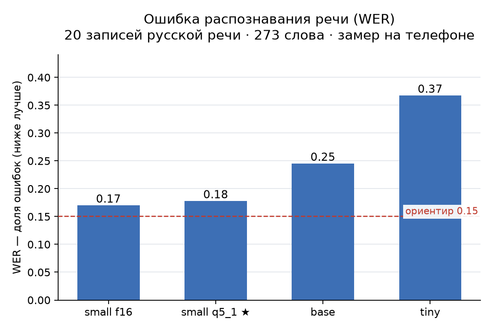
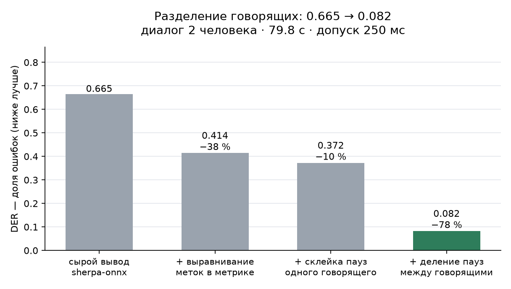
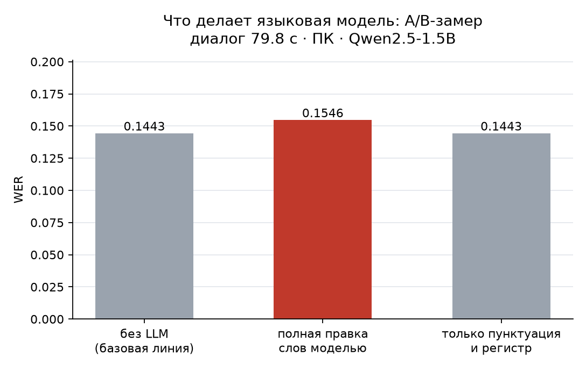

# Результаты тестов

## Юнит-тесты ядра

Команда: `cd android && ./gradlew test`

Покрыто: сшивка реплик, сериализация JSON, метрики.

| Набор | Проверок | Состояние |
|---|---|---|
| `MergeTest` | 7 | проходит |
| `TranscriptJsonTest` | 4 | проходит |
| `MetricsTest` | 13 | проходит |
| `PipelineTest` | 5 | проходит |
| **Итого** | **29** | **проходит** |

### Что именно проверяется

**Сшивка (`MergeTest`)**
- сегмент получает говорящего с наибольшим пересечением по времени;
- при отсутствии пересечения — `speaker_unknown`, а не догадка;
- пустой вход даёт пустой результат;
- форматирование таймкодов `[MM:SS]`;
- нормализация идентификаторов по первому появлению;
- сегменты с пустым текстом отбрасываются.

**JSON (`TranscriptJsonTest`)**
- ровно четыре поля на реплику, лишних нет;
- сортировка по `start_ms`;
- сериализация и разбор дают исходные данные;
- пустой список даёт пустой массив `transcript`.

**Метрики (`MetricsTest`)**
- WER: идентичный текст → 0; одна замена из двух слов → 0.5; вставка учитывается;
  пунктуация и регистр игнорируются; пустая гипотеза → 1.0;
- RTF: 30 с обработки на 60 с аудио → 0.5; нулевая длительность не делит на ноль;
- DER: идеальная разметка → 0; пропуск половины речи → ~0.5;
  переименование говорящих не считается ошибкой; слияние двух говорящих в одного → ошибка.

**Сквозной путь (`PipelineTest`)**
- весь путь «аудио → распознавание → диаризация → сшивка → пунктуация → JSON» проходит;
- этапы вызываются в правильном порядке;
- JSON содержит ровно четыре поля на реплику;
- говорящие назначаются из диаризации, а не выдумываются;
- отключение пунктуации меняет текст, но сохраняет число реплик и таймкоды;
- строки для языковой модели соответствуют формату `[MM:SS] Спикер N: текст`.

## Сборка

```
./gradlew assembleDebug   → BUILD SUCCESSFUL
APK: app/build/outputs/apk/debug/app-debug.apk (15 МБ)
minSdk 26, targetSdk 35, compileSdk 35
```

## Проверка офлайн-требования

```
aapt2 dump permissions app-debug.apk
```

Результат: разрешение `INTERNET` **отсутствует**. Приложение физически не может
обратиться к сети — требование ТЗ выполнено технически, а не декларативно.

## Замеры на реальных записях

Все замеры сделаны на устройстве — раздел ниже. Сводка: `docs/benchmarks/measurements.csv`.

Контрольный набор из трёх записей (чистая, шумная, с перебиванием) собран не полностью:
есть чистая запись диалога и две записи пользователя, шумной записи и записи
с перебиванием пока нет.

---

## Замеры на устройстве (SM-S938B, полный прогон 07.11.2026)

Все цифры получены на телефоне через `android/app/src/androidTest/` —
15 замеров на устройстве, все проходят. Сводка: `docs/benchmarks/measurements.csv`.

### Распознавание речи (20 записей VoxForge RU, 273 слова)

| Модель | WER | RTF | Размер | Вывод |
|---|---|---|---|---|
| tiny | 0.368 | 0.10 | 74 МБ | слишком много ошибок |
| base | 0.245 | 0.22 | 141 МБ | приемлемо |
| small f16 | 0.170 | 0.35 | 465 МБ | точнее всех, но тяжёлая |
| **small q5_1** | **0.178** | **0.31** | **181 МБ** | **выбрана: −284 МБ за +0.8 п.п. WER** |

Нормализация WER: регистр, пунктуация, ё/е. RTF на 20 коротких записях завышен
(whisper паддит каждый файл до 30 с), поэтому для small приведён замер на
диалоге 80 с — 0.31.



### Диаризация (диалог 2 говорящих, 79.8 с)

| Метрика | Значение |
|---|---|
| DER (допуск 250 мс, выравнивание меток) | **0.082** |
| Найдено говорящих | 2 из 2 |
| RTF | 0.17 |

Улучшение дала не смена модели, а постобработка: 0.665 → 0.082 за четыре шага.
Подробности шагов — `docs/ML_MODELS.md`.



### Локальная LLM (Qwen2.5-0.5B Q4_K_M)

| Метрика | Значение |
|---|---|
| WER до/после пунктуации | **0.0000** (слова не меняются) |
| Время на реплику | ~1.2 с |
| Размер модели | 469 МБ |

Роль модели узкая сознательно: A/B-замер на ПК показал, что правка слов моделью
ухудшает WER (0.1443 → 0.1546), а пунктуация и регистр его не меняют. Поэтому
режим правки слов отклонён, а результат пунктуации принимается только после
проверки — при потере более 5 % слов происходит откат к тексту ASR.



Почему выбрана 0.5B и что осталось незамеренным — `docs/ML_MODELS.md`,
раздел «Локальная LLM: почему именно Qwen2.5».

### Сквозной путь (аудио → JSON)

`PipelineE2ETest`: этапы ASR → DIARIZATION → MERGE → LLM → DONE, 11 реплик,
2 говорящих, RTF 0.65. JSON проверен на схему ТЗ: четыре поля, целые
миллисекунды, порядок по `start_ms`, `end_ms >= start_ms`, без `speaker_unknown`.

### Release-сборка

- `aapt2 dump permissions`: только RECORD_AUDIO, FOREGROUND_SERVICE,
  FOREGROUND_SERVICE_DATA_SYNC, POST_NOTIFICATIONS. **INTERNET нет.**
- Классов `Stubs` в dex нет — заглушки вынесены в тестовый набор.
- Устанавливается и запускается в авиарежиме, интерфейс целый.
