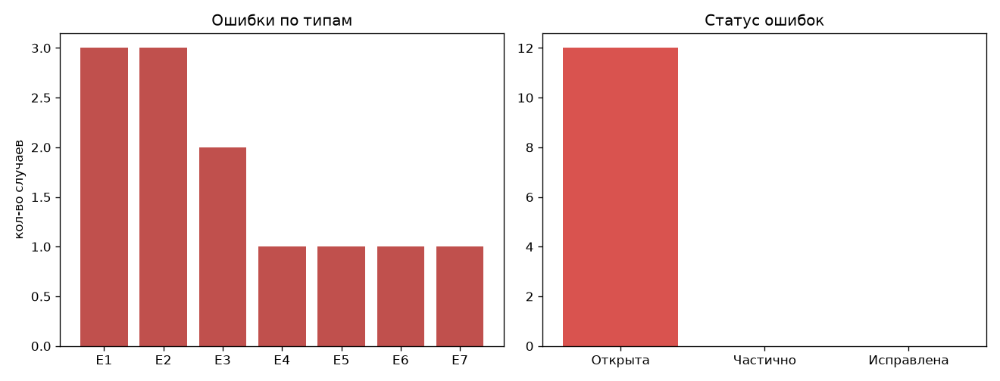
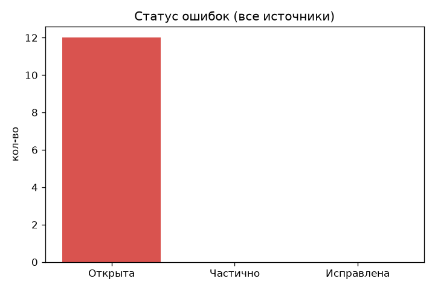

# Анализ ошибок по типам (все прогоны + ПК-замеры)

Каждая ошибка классифицирована по типу, привязана к прогону/тесту и к данным,
из которых она следует. Никаких выдуманных цифр: источник указан у каждой строки.
Графики строятся `tools/make_error_charts.py` из таблиц этого файла.

## Типы ошибок (кодировка)

| Код | Тип | Что это | Баллы ТЗ под угрозой |
|---|---|---|---|
| E1 | Скорость (RTF) | инференс медленнее цели RTF<1 | 10 (скорость) + UX |
| E2 | Потеря речи | часть записи не попала в транскрипт | 40 (WER) + 10 (метки) |
| E3 | Галлюцинации | текст на тишине/шуме, додуманные слова | 40 (WER) |
| E4 | Мусорные токены | [_BEG_], [_TT_*] в тексте | UX, чистота JSON |
| E5 | Спикеры | диаризации нет / ошибки разделения | 25 (диаризация) |
| E6 | Таймкоды | сдвиг/неточные границы реплик | 10 (метки) |
| E7 | Шум | деградация WER на шумной записи | 40 (WER) |

## Реестр ошибок

| # | Тип | Прогон/тест | Данные (источник) | Статус | Чем лечим |
|---|---|---|---|---|---|
| 1 | E1 | run-001 | RTF=16.44 (small, logcat телефона) | Частично: модель заменена | base→tiny |
| 2 | E1 | run-002 | RTF=5.88 (base, logcat телефона) | Открыта | tiny / sherpa-onnx |
| 3 | E2 | run-001 | 2 реплики на 31.5 с (logcat) | Открыта | VAD-чанкинг |
| 4 | E2 | run-002 | 1 реплика [0..7000] на 13 568 мс (logcat) | Открыта | VAD-чанкинг |
| 5 | E3 | run-002 | «Брецборок», «5-я с Крышом» (logcat) | Открыта | денойз + tiny/base A/B |
| 6 | E4 | run-001 | [_BEG_], [_TT_100] в тексте | **Исправлена** cf1d643 | фильтр токенов в JNI |
| 7 | E5 | все прогоны | диаризация не реализована в whisper.cpp-стеке | Открыта | sherpa-onnx pyannote+3D-Speaker (есть в main) |
| 8 | E6 | run-002 | единственный сегмент 0–7000 мс, границы грубые | Открыта | word timestamps / VAD |
| 9 | E7 | ПК-тест denoise | белый 0 дБ: WER 0.277→0.231; гул 5 дБ: 0.108→0.123 (be8aad9) | Частично закрыта | защитные правила SNR в denoise.py |
| 10 | E1 | run-003 | RTF=3.85 (tiny, logcat телефона) | Открыта | sherpa-onnx Zipformer/GigaAM |
| 11 | E3 | run-003 | текст почти сплошь бессмысленный, петли «как лет»×4, «громкий»×3 (logcat) | Открыта | tiny не тянет русский → смена стека |
| 12 | E2 | run-003 | 1 сегмент 0–25600 на всю запись (logcat) | Открыта | VAD (есть в sherpa-onnx) |

## Что уже исправлено и проверено

- E4 (спецтокены): фильтр в whisper_jni.cpp, в run-002 мусора нет — подтверждено.
- E1 частично: small→base дал ×2.8 ускорения (16.44→5.88), замерено на телефоне.
- E7 на ПК: denoise.py с самозащитой (204 теста зелёные на origin/main).

## Главные открытые риски (приоритет)

1. **E2 Потеря речи** — бьёт сразу по 50 баллам (WER+метки). Следующий шаг:
   VAD-чанкинг перед whisper или переход на sherpa-onnx (VAD из коробки).
2. **E1 Скорость** — tiny на телефоне (run-003) даст ответ, хватит ли
   whisper.cpp в принципе; запасной путь — Zipformer/GigaAM в sherpa-onnx.
3. **E5 Спикеры** — в нашем стеке не реализовано; в main (sherpa-onnx) уже есть.

