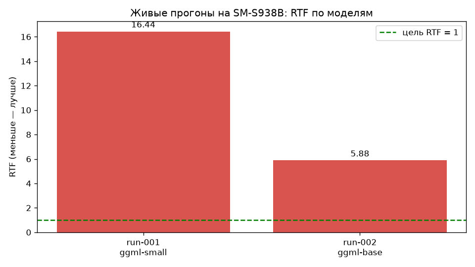

# Архив живых прогонов на телефоне (SM-S938B)

Каждый прогон = один markdown-отчёт `run-NNN.md` с:
- параметрами (модель, коммит, длина записи);
- замером RTF и времени инференса;
- полным транскриптом из logcat;
- разбором ошибок: шум, паузы, потерянная речь, спикеры, таймкоды;
- выводом и следующим шагом.

Сводные графики по всем прогонам: `docs/img/runs_rtf.png` (строится
`tools/make_run_charts.py` из таблицы ниже — ничего не выдумано).

## Сводная таблица

| Прогон | Модель | Коммит | Аудио, мс | Инференс, мс | RTF | Реплик | Главная проблема |
|---|---|---|---|---|---|---|---|
| [run-001](run-001.md) | ggml-small | 09709dc | 31 488 | 517 773 | 16.44 | 2 | Скорость; мусорные токены; потеря речи |
| [run-002](run-002.md) | ggml-base | cf1d643 | 13 568 | 79 829 | 5.88 | 1 | Скорость; потеря речи (1 реплика на 13.5 с) |
| run-003 | ggml-tiny | 545a3fb | TODO | TODO | TODO | TODO | Ожидает прогона |

